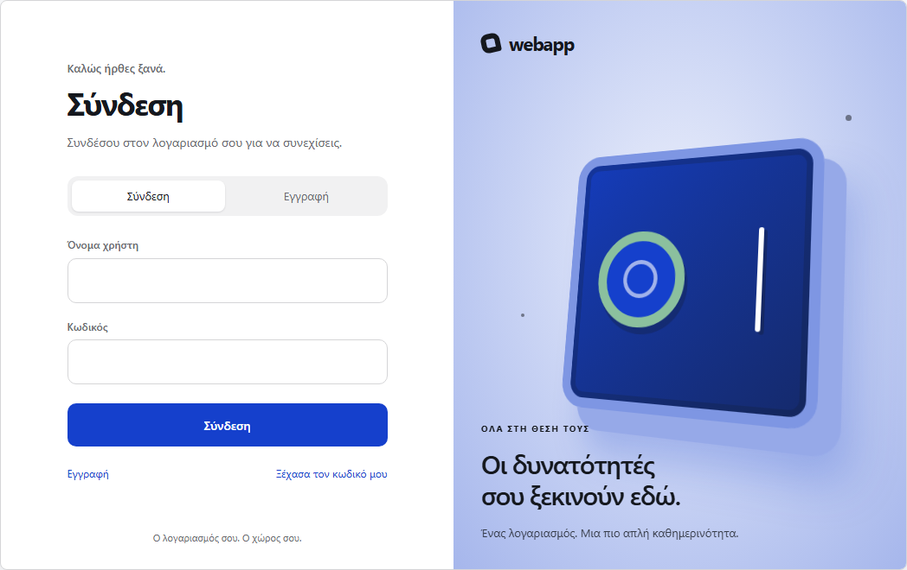

# webapp

Εφαρμογή **Next.js + TypeScript** με ολοκληρωμένο σύστημα χρηστών, **Prisma / MySQL**, κοινή αποστολή email και οργάνωση σε ανεξάρτητα modules.

[](https://github.com/pagovitsa/webapp/actions/workflows/check.yml)

## Τι περιλαμβάνει

- Ανοιχτή εγγραφή με username/password και επιβεβαίωση email.
- Σύνδεση, προστατευμένο προφίλ και αποσύνδεση με ανάκληση συνεδρίας.
- Ανάκτηση κωδικού με σύνδεσμο μίας χρήσης και ακύρωση προηγούμενων συνεδριών.
- Τρεις εμφανίσεις για όλες τις φόρμες: **Nucleus**, **Smart Save**, **Midnight**. Προεπιλογή: **Smart Save**.
- JSON HTTP API, [OpenAPI contract](src/modules/users/openapi.json) και ελληνικό UI.
- Μόνιμη MySQL, Prisma migrations και κοινός SMTP connector. Τοπική ανάπτυξη/δοκιμές με Docker και Mailpit.



Το `users` είναι η ενεργή ενότητα αναφοράς. Το αρχικό δοκιμαστικό module παραγγελιών έχει αφαιρεθεί.

## Εκκίνηση

Απαιτούνται **Node 26** (δες `.nvmrc`), **npm 11+** και ενεργό **Docker Engine**. Στα Windows ο helper χρησιμοποιεί το Docker του **WSL Debian**· στο Linux το native Docker.

```bash
npm ci
npm run services:up
npm run auth:migrate
npm run dev
```

Το `services:up` δημιουργεί, μόνο αν λείπουν, τα ignored `.env.mysql.local` και `.env.local` με τυχαία credentials. Δεν αντικαθιστά υπάρχουσες ρυθμίσεις και δεν διαγράφει δεδομένα. Το `.env.example` περιγράφει τις απαιτούμενες μεταβλητές· τα placeholders του δεν είναι έτοιμα credentials.

| Υπηρεσία | Τοπική διεύθυνση |
|---|---|
| Αρχική σελίδα | [localhost:3000](http://localhost:3000) |
| Σύνδεση / εγγραφή | [Σύνδεση](http://localhost:3000/users/login) · [Εγγραφή](http://localhost:3000/users/register) |
| Προφίλ | [Ο λογαριασμός μου](http://localhost:3000/users), απαιτεί σύνδεση |
| Δοκιμαστικά email | [Mailpit](http://127.0.0.1:18025) |
| MySQL / SMTP | `127.0.0.1:13306` / `127.0.0.1:12525` |

**Στην τοπική εγκατάσταση τα email εμφανίζονται στο Mailpit, όχι στο Gmail ή άλλο πραγματικό γραμματοκιβώτιο.** Κάνε εγγραφή, άνοιξε εκεί το μήνυμα επιβεβαίωσης και μετά συνδέσου. Η ανάκτηση κωδικού χρησιμοποιεί το ίδιο γραμματοκιβώτιο.

Η MySQL κρατά τα δεδομένα στο volume `webapp-mysql-data`, με χωριστούς non-root χρήστες και βάσεις `webapp_dev` / `webapp_test`. Διατήρησε τα αρχεία credentials μαζί με το volume: η διαγραφή των env αρχείων δεν επαναρυθμίζει μια ήδη αρχικοποιημένη βάση.

## Εμφανίσεις

Η επιλογή γίνεται κεντρικά στο [auth-appearance.ts](src/modules/users/presentation/auth-appearance.ts):

```ts
export const authAppearance: AuthAppearance = "smart-save";
```

Διαθέσιμες τιμές: `nucleus`, `smart-save`, `midnight`. Η ίδια επιλογή εφαρμόζεται σε σύνδεση, εγγραφή, ανάκτηση και νέο κωδικό. Οι προεπισκοπήσεις είναι μόνο για οπτικό έλεγχο, με απενεργοποιημένες υποβολές:

- [Nucleus](http://localhost:3000/users/previews/nucleus)
- [Smart Save](http://localhost:3000/users/previews/smart-save)
- [Midnight](http://localhost:3000/users/previews/midnight)

## API και ασφάλεια

Οι σελίδες χρησιμοποιούν Server Actions και διατίθενται επίσης JSON endpoints. Οι μεταβολές περνούν από κοινό handler με έλεγχο origin/CSRF και rate limiting. Το προφίλ διαβάζεται από `GET /api/users/me` με cookie συνεδρίας· χωρίς έγκυρη σύνδεση επιστρέφει 401.

Οι συνεδρίες αποθηκεύονται στη βάση, οι κωδικοί ως μονόδρομα hashes και το cookie είναι HttpOnly / SameSite, με Secure σε HTTPS. Οι αποκρίσεις του API δεν εκθέτουν password hashes ή session tokens. Αποτυχία ανάκλησης συνεδρίας δεν αναφέρεται ως επιτυχές logout.

Αναλυτικές διαδρομές, κανόνες και περιορισμοί: [README users](src/modules/users/README.md) και [OpenAPI](src/modules/users/openapi.json).

## Έλεγχοι

```bash
npm run check
npx playwright install chromium
npm run test:e2e
```

Το `check` εκτελεί typecheck, lint, αρχιτεκτονικούς ελέγχους, unit/tooling tests και production build. Τα browser/API tests εκκινούν MySQL και Mailpit, εφαρμόζουν migrations και χρησιμοποιούν αποκλειστικά τη δοκιμαστική βάση. Καλύπτουν τις ροές χρηστών, τις τρεις εμφανίσεις, την αντίθεση κειμένων, το mobile layout και τις απορρίψεις ασφαλείας.

Το [GitHub Actions workflow](.github/workflows/check.yml) εκτελεί καθαρή εγκατάσταση και τους ίδιους ελέγχους σε κάθε pull request και μετά από αλλαγή του main.

## Εντολές

| Εντολή | Τι κάνει |
|---|---|
| `npm run services:up` | Τοπική MySQL και Mailpit μέσω Docker |
| `npm run auth:migrate` | Εφαρμογή εκκρεμών migrations στη ρυθμισμένη βάση |
| `npm run dev` | Παραγωγή Prisma client και dev server |
| `npm run build` / `npm start` | Production build / εκτέλεσή του |
| `npm run check` | typecheck → lint → arch → test → build. Υποχρεωτικό πριν από κάθε merge. |
| `npm run module:new -- <όνομα> [--page]` | Νέο module από το template |
| `npm run arch` | Έλεγχος αρχιτεκτονικών ορίων (dependency-cruiser) |
| `npm run test` | Unit tests (Vitest) + tests κανόνων ορίων και generator (`node --test`) |
| `npm run test:e2e` | Browser tests (Playwright) πάνω σε production build |

## Παραγωγή

Ο τοπικός Docker helper προορίζεται για ανάπτυξη και δοκιμές. Πριν από production χρειάζονται πραγματικό SMTP και κατάλληλος αποστολέας, HTTPS, ξεχωριστά μυστικά, MySQL με backups και proxy που αντικαθιστά τα forwarded IP headers. Η εξωτερική παράδοση email και το production deployment δεν αποτελούν μέρος της τοπικής δοκιμαστικής εγκατάστασης.

## Ροή εργασίας

- Καμία αλλαγή απευθείας στο `main`. Κάθε εργασία σε δικό της branch (`feature/…`, `fix/…`, `starter/…`) και pull request.
- Merge μόνο όταν το CI του pull request είναι πράσινο.
- Λεπτομέρειες: [AGENTS.md](AGENTS.md) §8.

## Τεκμηρίωση

| Αρχείο | Περιεχόμενο |
|---|---|
| [docs/architecture.md](docs/architecture.md) | Κανόνες οργάνωσης και εξαρτήσεων |
| [docs/structure-and-flow.md](docs/structure-and-flow.md) | Πραγματικές ροές UI, API, συνεδριών και υποδομής μέσα από το users |
| [docs/new-module.md](docs/new-module.md) | Πώς φτιάχνεται νέο module |
| [docs/new-project.md](docs/new-project.md) | Πώς ξεκινά νέο project από αυτό το starter |
| [AGENTS.md](AGENTS.md) | Υποχρεωτικοί κανόνες για AI agents (το `CLAUDE.md` το φορτώνει για το Claude Code) |
| [src/modules/users/README.md](src/modules/users/README.md) | Δημόσιο API, κανόνες χρηστών, επιλογές εμφάνισης και λειτουργικοί περιορισμοί |
